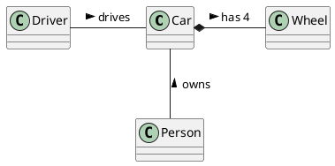

# Sample Documentation

This is a comprehensive example demonstrating all supported Markdown features that can be converted to Confluence Storage Format.

141


## Introduction

Welcome to the **md2cf** documentation. This tool allows you to convert Markdown files to Confluence pages seamlessly.

## Text Formatting

You can use various text formatting options:
- **Bold text** using double asterisks

- *Italic text* using single asterisks

- ~~Strikethrough text~~ using double tildes

- `Inline code` using backticks


Combined formatting: **bold with *nested italic* text** and *italic with **nested bold** text*.

## Headings

This document demonstrates all heading levels:

### Level 3 Heading

Regular content under level 3.

#### Level 4 Heading

Regular content under level 4.

##### Level 5 Heading

Regular content under level 5.

###### Level 6 Heading

Regular content under level 6.

## Lists

### Unordered Lists

Funktioniert nicht auf oberster Ebene.

Aber darunter bleiben die Listen erhalten:
- First item

- Second item
    - Nested item 1

    - Nested item 2


- Third item


### Ordered Lists

1. First step

2. Second step
    1. Substep 2.1

    2. Substep 2.2


3. Third step


### Mixed Lists

4. Ordered item
    - Unordered nested item

    - Another unordered item


5. Another ordered item


## Code Examples

### Inline Code

Use the `print()` function to display output in Python.


### Code Blocks

Here's a Python example:
- ```python
  def fibonacci(n):
  """Calculate the nth Fibonacci number."""
  if n <= 1:
  return n
  return fibonacci(n - 1) + fibonacci(n - 2)
  
  # Calculate first 10 Fibonacci numbers
  for i in range(10):
  print(f"F({i}) = {fibonacci(i)}")
  ```


JavaScript example:
- ```javascript
  const greet = (name) => {
  console.log(`Hello, ${name}!`);
  };
  
  greet('World');
  ```


Shell script:
- ```bash
  #!/bin/bash
  for file in *.md; do
  md2cf convert "$file" -o "${file%.md}.html"
  done
  ```


Plain text code block:
- ```
  This is a plain text code block
  without syntax highlighting.
  ```


## Links

Here are various types of links:
- [Simple link](https://www.example.com)

- [Link with title](https://www.example.com "Example Website")

- External link: <https://github.com>


## Images

{:width 123}

{:width "200px"}

## Diagrams



## Tables

### Simple Table


| Feature | Supported | Notes |
|---------|-----------|-------|
| Headings | Yes | All levels (H1-H6) |
| Lists | Yes | Ordered and unordered |
| Code | Yes | Inline and blocks |
| Tables | Yes | With alignment |

### Table with Alignment

| Left Aligned | Center Aligned | Right Aligned |
|:-------------|:--------------:|--------------:|
| Item 1       | Item 2         | Item 3        |
| Value A      | Value B        | Value C       |
| Data X       | Data Y         | Data Z        |

### Complex Table

| Component | Description | Status | Priority |
|-----------|-------------|--------|----------|
| Renderer | Converts MD to Confluence format | ✅ Complete | High |
| API Client | Handles Confluence REST API | ✅ Complete | High |
| CLI | Command-line interface | ✅ Complete | Medium |
| Tests | Unit and integration tests | ✅ Complete | High |

## Blockquotes

> This is a blockquote.
> It can span multiple lines.

> **Important Note:**
> You can include formatting inside blockquotes.

Nested blockquotes:

> This is the outer quote.
>
> > This is nested inside.

## Horizontal Rules

Content above the line.

---

Content below the line.

## Advanced Features

### Task Lists

- [x] Implement Mistune renderer
  :LOGBOOK:
  CLOCK: [2025-10-22 Wed 16:15:11]--[2025-10-22 Wed 16:15:12] =>  00:00:01
  :END:

- [x] Create Confluence API client

- [x] Build CLI interface

- [ ] Write comprehensive tests

- [ ] Add more examples
  :LOGBOOK:
  CLOCK: [2025-10-22 Wed 16:15:24]--[2025-10-22 Wed 16:15:24] =>  00:00:00
  :END:

### Zweite Task Liste

- [ ] Noch zu tun

- [x] ist schon erledigt
  :LOGBOOK:
  CLOCK: [2025-10-23 Thu 13:25:05]--[2025-10-23 Thu 13:25:06] =>  00:00:01
  :END:

### Mixed Content

You can combine different elements:

6. **Code example** with explanation:
    ```python
    result = [x * 2 for x in range(10)]
    print(result)
    ```

7. **Table** showing results:
    | Input | Output |
    |-------|--------|
    | 0     | 0      |
    | 1     | 2      |
    | 2     | 4      |

8. **Quote** from documentation:
    > Always validate your input data before processing.

## Best Practices

When converting Markdown to Confluence:
:LOGBOOK:
CLOCK: [2025-10-23 Thu 11:04:41]--[2025-10-23 Thu 11:04:43] =>  00:00:02
:END:
- Use descriptive headings for better navigation

- Include code blocks with language specification for syntax highlighting

- Keep tables simple and readable

- Use lists to break down complex information

- Add images with descriptive alt text


## Conclusion

This example demonstrates all major Markdown features supported by **md2cf**. Use this as a template for your own documentation.

For more information, visit the [project repository](https://github.com/yourusername/md2cf).

---

*Last updated: 2025*

